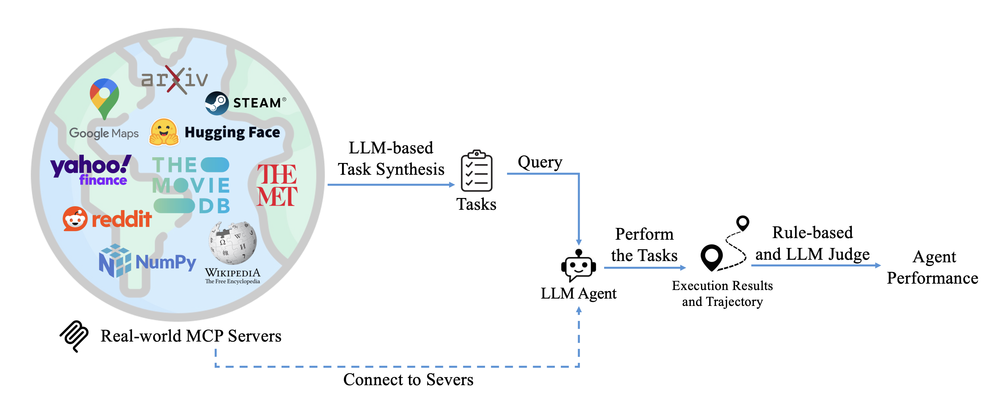

# MCP-Bench: Benchmarking Tool-Using LLM Agents via Model Context Protocol

[](https://arxiv.org/abs/2508.20453)
[](https://huggingface.co/spaces/mcpbench/mcp-bench)
[](https://opensource.org/licenses/Apache-2.0)
[](https://www.python.org/downloads/)
[](https://github.com/anthropics/mcp)



## Overview

MCP-Bench is a comprehensive benchmarking framework for evaluating Large Language Models' (LLMs) capabilities in tool-use scenarios through the [Model Context Protocol (MCP)](https://github.com/anthropics/mcp). The benchmark assesses how effectively LLMs can discover, select, and utilize tools to solve complex real-world tasks across 28 diverse MCP servers.

### Key Features

- **28 MCP Servers**: Diverse tools spanning biomedical research, space data, weather, academic papers, cryptocurrency, cultural resources, and more
- **Multi-Round Task Execution**: Supports complex tasks requiring multiple tool calls across different servers
- **Comprehensive Evaluation**: LLM-as-judge evaluation with stability testing and rule-based metrics
- **Configurable Pipeline**: Flexible configuration system for customizing execution parameters, timeouts, and evaluation settings
- **Tool Caching**: Intelligent caching mechanism to reduce redundant API calls
- **Task Synthesis**: Automated task generation for single-server and multi-server scenarios

## News

* [2025-09] MCP-Bench accepted to NeurIPS 2025 Workshop on Scaling Environments for Agents

## Leaderboard

| Rank | Model | Overall Score |
|------|-------|---------------|
| 1 | gpt-5 | 0.749 |
| 2 | o3 | 0.715 |
| 3 | gpt-oss-120b | 0.692 |
| 4 | gemini-2.5-pro | 0.690 |
| 5 | claude-sonnet-4 | 0.681 |
| 6 | qwen3-235b-a22b-2507 | 0.678 |
| 7 | glm-4.5 | 0.668 |
| 8 | gpt-oss-20b | 0.654 |
| 9 | kimi-k2 | 0.629 |
| 10 | qwen3-30b-a3b-instruct-2507 | 0.627 |
| 11 | gemini-2.5-flash-lite | 0.598 |
| 12 | gpt-4o | 0.595 |
| 13 | gemma-3-27b-it | 0.582 |
| 14 | llama-3-3-70b-instruct | 0.558 |
| 15 | gpt-4o-mini | 0.557 |
| 16 | mistral-small-2503 | 0.530 |
| 17 | llama-3-1-70b-instruct | 0.510 |
| 18 | nova-micro-v1 | 0.508 |
| 19 | llama-3-2-90b-vision-instruct | 0.495 |
| 20 | llama-3-1-8b-instruct | 0.428 |

*Overall Score represents the average performance across all evaluation dimensions including rule-based schema understanding, LLM-judged (o4-mini as judge model) task completion, tool usage, and planning effectiveness. Scores are averaged across single-server and multi-server settings.*

## Installation

### Prerequisites

- Python 3.10+
- Node.js (for Node-based MCP servers)
- Conda or virtualenv

### Setup Steps

1. **Clone the repository**

```bash
git clone https://github.com/accenture/mcp-bench.git
cd mcp-bench
```

2. **Create and activate Python environment**

```bash
conda create -n mcpbench python=3.10
conda activate mcpbench
```

3. **Install MCP server dependencies**

```bash
cd mcp_servers
bash ./install.sh
cd ..
```

4. **Configure API keys**

Create a [.env](.env) file in the project root for OpenAI:

```bash
export OPENAI_API_KEY="your_openai_api_key_here"
```

Some MCP servers require external API keys. Configure them in [mcp_servers/api_key](mcp_servers/api_key):

Required API keys (free and easy to obtain):
- **NPS_API_KEY**: National Park Service API - [Get key](https://www.nps.gov/subjects/developer/get-started.htm)
- **NASA_API_KEY**: NASA Open Data API - [Get key](https://api.nasa.gov/)
- **HF_TOKEN**: Hugging Face token - [Get token](https://huggingface.co/docs/hub/security-tokens)
- **GOOGLE_MAPS_API_KEY**: Google Maps API - [Get key](https://developers.google.com/maps)
- **NCI_API_KEY**: National Cancer Institute API - [Get key](https://clinicaltrialsapi.cancer.gov/signin)

Note: The NCI API key registration may require a US IP address. See Issue #10 if you encounter difficulties.

5. **Verify MCP server connectivity**

```bash
python ./utils/collect_mcp_info.py
```

You should see "28/28 servers connected" and "All successfully connected servers returned tools!"

## Usage

### Running Benchmarks

1. **List available models**

```bash
source .env
python run_benchmark.py --list-models
```

2. **Run benchmark on all tasks**

```bash
source .env
python run_benchmark.py --models gpt-oss-20b
```

3. **Run benchmark on specific task subsets**

Single-server tasks:
```bash
source .env
python run_benchmark.py --models gpt-oss-20b \
  --tasks-file tasks/mcpbench_tasks_single_runner_format.json
```

Two-server tasks:
```bash
source .env
python run_benchmark.py --models gpt-oss-20b \
  --tasks-file tasks/mcpbench_tasks_multi_2server_runner_format.json
```

Three-server tasks:
```bash
source .env
python run_benchmark.py --models gpt-oss-20b \
  --tasks-file tasks/mcpbench_tasks_multi_3server_runner_format.json
```

### Generating Benchmark Tasks

See [synthesis/README.md](synthesis/README.md) for detailed task generation instructions.

Generate single-server tasks:
```bash
python synthesis/generate_benchmark_tasks.py \
  --mode single \
  --filter-problematic \
  --tasks-per-combination 2 \
  --output tasks/benchmark_tasks_single.json
```

Generate multi-server tasks:
```bash
python synthesis/generate_benchmark_tasks.py \
  --mode multi \
  --combinations-file synthesis/split_combinations/mcp_2server_combinations.json \
  --filter-problematic \
  --tasks-per-combination 2 \
  --output tasks/benchmark_tasks_multi_2server.json
```

### Running Ablation Studies

The framework includes support for ablation studies to evaluate model performance under varying conditions with distraction servers.

Generate ablation study tasks:
```bash
bash run_ablation_study.sh
```

This script generates tasks with different distraction levels:
- Single-server tasks with distraction servers
- 2-server tasks with distraction servers
- 3-server tasks with distraction servers

Run ablation study benchmarks:
```bash
bash run_ablation_benchmark.sh
```

Generated ablation study data is stored in timestamped directories under [ablation_studies/](ablation_studies/).

### Configuration

The benchmark behavior can be customized via [config/benchmark_config.yaml](config/benchmark_config.yaml):

- **Execution settings**: Timeouts, retry limits, max rounds
- **Tool filtering**: Problematic tools, sequential-only tools
- **Caching**: Tool call caching configuration
- **Evaluation**: Judge stability testing, dependency analysis
- **Task generation**: Tasks per combination, retry limits

## Architecture

### Core Components

- **[agent/](agent/)** - Multi-round task execution engine
  - [executor.py](agent/executor.py) - `TaskExecutor` class that orchestrates multi-round execution with planning, tool calls, retry logic, and result synthesis
  - [execution_context.py](agent/execution_context.py) - `ExecutionContext` class managing retry state, compression tracking, and idempotent operations

- **[benchmark/](benchmark/)** - Evaluation and results processing framework
  - [runner.py](benchmark/runner.py) - `BenchmarkRunner` orchestrating benchmark execution across models with async connection management
  - [evaluator.py](benchmark/evaluator.py) - `TaskEvaluator` and `LLMJudge` classes implementing 6-dimension LLM-as-judge evaluation and compliance metrics
  - [results_aggregator.py](benchmark/results_aggregator.py) - `ResultsAggregator` computing comprehensive performance metrics across evaluations
  - [results_formatter.py](benchmark/results_formatter.py) - `ResultsFormatter` for human-readable output generation

- **[mcp_modules/](mcp_modules/)** - MCP protocol integration layer
  - [connector.py](mcp_modules/connector.py) - `MCPConnector` managing individual server connections (STDIO/HTTP transports) and tool discovery
  - [server_manager.py](mcp_modules/server_manager.py) - `MultiServerManager` coordinating multiple server connections
  - [server_manager_persistent.py](mcp_modules/server_manager_persistent.py) - `PersistentMultiServerManager` with connection reuse optimization
  - [tool_cache.py](mcp_modules/tool_cache.py) - `ToolCache` implementing SQLite-based multi-process safe caching with TTL support

- **[llm/](llm/)** - LLM provider integration layer
  - [factory.py](llm/factory.py) - `LLMFactory` and `ModelConfig` supporting OpenAI and Gemini models with automatic discovery
  - [provider.py](llm/provider.py) - `LLMProvider` with unified interface, retry logic, exponential backoff, and JSON repair

- **[synthesis/](synthesis/)** - Task generation and synthesis
  - [task_synthesis.py](synthesis/task_synthesis.py) - `TaskSynthesizer` with LLM-based generation, fuzzy conversion, and quality evaluation
  - [benchmark_generator.py](synthesis/benchmark_generator.py) - `BenchmarkTaskGenerator` for single/multi-server and ablation study tasks
  - [generate_benchmark_tasks.py](synthesis/generate_benchmark_tasks.py) - CLI script for batch task generation
  - [split_combinations/](synthesis/split_combinations/) - Pre-computed 2-server and 3-server combinations

- **[config/](config/)** - Configuration management system
  - [benchmark_config.yaml](config/benchmark_config.yaml) - Central YAML configuration with connection, execution, and evaluation settings
  - [config_loader.py](config/config_loader.py) - `BenchmarkConfig` singleton with 3-level hierarchy (defaults → YAML → env vars)

- **[utils/](utils/)** - Utility functions and helpers
  - [collect_mcp_info.py](utils/collect_mcp_info.py) - `MCPServerInfoCollector` for server discovery, tool schema collection, and connectivity validation
  - [local_server_config.py](utils/local_server_config.py) - `LocalServerConfigLoader` for parsing server commands and environment configuration
  - [error_handler.py](utils/error_handler.py) - Centralized error handling, classification, and recovery strategies

- **[ablation_studies/](ablation_studies/)** - Generated ablation study tasks and results
  - Timestamped directories containing single-server and multi-server task variations
  - Generated via [run_ablation_study.sh](run_ablation_study.sh) with configurable distraction levels

### Root Scripts

- **[run_benchmark.py](run_benchmark.py)** - Main entry point for executing benchmarks across models and task sets
- **[run_ablation_study.sh](run_ablation_study.sh)** - Generates ablation study tasks with controlled distraction servers
- **[run_ablation_benchmark.sh](run_ablation_benchmark.sh)** - Executes benchmarks on generated ablation study tasks

### Execution Flow

1. **Initialization**: `BenchmarkRunner` connects to configured MCP servers via `PersistentMultiServerManager` and discovers available tools
2. **Task Loading**: Load benchmark tasks from JSON files (single-server, 2-server, or 3-server configurations)
3. **Planning**: `TaskExecutor` uses LLM to analyze task and generate structured plans with tool selections
4. **Execution**: Execute planned tool calls across MCP servers with `ToolCache` reducing redundant API calls
5. **Iteration**: Repeat planning and execution until task completion, max rounds reached, or timeout
6. **Evaluation**: `TaskEvaluator` assesses compliance and `LLMJudge` scores on 6 dimensions (fulfillment, grounding, tool appropriateness, parameter accuracy, dependency awareness, parallelism)
7. **Aggregation**: `ResultsAggregator` computes statistics and `ResultsFormatter` generates reports

### Configuration System

The project uses a **3-level configuration hierarchy** (in priority order):

1. **Environment Variables** (highest) - Override any setting via `BENCHMARK_SECTION_SUBSECTION_KEY=value`
2. **YAML Configuration** (medium) - Centralized in [config/benchmark_config.yaml](config/benchmark_config.yaml)
3. **Hardcoded Defaults** (lowest) - Built into [config/config_loader.py](config/config_loader.py)

## MCP Servers

The benchmark includes 28 diverse MCP servers covering various domains:

| Server | Description | Domain |
|--------|-------------|--------|
| [BioMCP](https://github.com/genomoncology/biomcp) | Biomedical research data, clinical trials, and health information | Healthcare |
| [Bibliomantic](https://github.com/d4nshields/bibliomantic-mcp-server) | I Ching divination, hexagrams, and mystical guidance | Divination |
| [Call for Papers](https://github.com/iremert/call-for-papers-mcp) | Academic conference submissions and announcements | Academia |
| [Car Price Evaluator](https://github.com/yusaaztrk/car-price-mcp-main) | Vehicle valuation and automotive market analysis | Automotive |
| [Context7](https://github.com/upstash/context7) | Project context management and documentation | Development |
| [DEX Paprika](https://github.com/coinpaprika/dexpaprika-mcp) | Cryptocurrency DeFi analytics and DEX data | Finance |
| [FruityVice](https://github.com/CelalKhalilov/fruityvice-mcp) | Comprehensive fruit nutrition information | Health |
| [Game Trends](https://github.com/halismertkir/game-trends-mcp) | Gaming industry statistics and trend analysis | Gaming |
| [Google Maps](https://github.com/cablate/mcp-google-map) | Location services, geocoding, and mapping | Geography |
| [Huge Icons](https://github.com/hugeicons/mcp-server) | Icon search and design resources | Design |
| [Hugging Face](https://github.com/shreyaskarnik/huggingface-mcp-server) | ML models, datasets, and AI capabilities | AI/ML |
| [Math MCP](https://github.com/EthanHenrickson/math-mcp) | Mathematical calculations and operations | Mathematics |
| [Medical Calculator](https://github.com/vitaldb/medcalc) | Clinical calculation tools and medical formulas | Healthcare |
| [Metropolitan Museum](https://github.com/mikechao/metmuseum-mcp) | Art collection database and museum information | Culture |
| [Movie Recommender](https://github.com/iremert/movie-recommender-mcp) | Film recommendations and movie metadata | Entertainment |
| [NASA Data](https://github.com/AnCode666/nasa-mcp) | Space mission data and astronomical information | Space |
| [National Parks](https://github.com/KyrieTangSheng/mcp-server-nationalparks) | US National Parks information and visitor services | Travel |
| [NixOS](https://github.com/utensils/mcp-nixos) | Package management and system configuration | DevOps |
| [OKX Exchange](https://github.com/esshka/okx-mcp) | Cryptocurrency trading data and market info | Finance |
| [OpenAPI Explorer](https://github.com/janwilmake/openapi-mcp-server) | API specification exploration and testing | Development |
| [OSINT Intelligence](https://github.com/himanshusanecha/mcp-osint-server) | Open source intelligence gathering | Security |
| [Paper Search](https://github.com/openags/paper-search-mcp) | Academic paper search across research databases | Academia |
| [Reddit](https://github.com/dumyCq/mcp-reddit) | Social media content and community discussions | Social Media |
| [Scientific Computing](https://github.com/Aman-Amith-Shastry/scientific_computation_mcp) | Advanced mathematical computations and analysis | Science |
| [Time MCP](https://github.com/dumyCq/time-mcp) | Date, time utilities, and timezone conversions | Utilities |
| [Unit Converter](https://github.com/zazencodes/unit-converter-mcp) | Measurement conversions across unit systems | Utilities |
| [Weather Data](https://github.com/HarunGuclu/weather_mcp) | Weather forecasts and meteorological information | Weather |
| [Wikipedia](https://github.com/Rudra-ravi/wikipedia-mcp) | Encyclopedia content search and retrieval | Knowledge |

## Project Structure

```
mcp-bench/
├── agent/                          # Task execution engine
│   ├── executor.py                 # TaskExecutor: multi-round orchestration with retry logic
│   └── execution_context.py       # ExecutionContext: state and compression tracking
├── benchmark/                      # Evaluation framework
│   ├── runner.py                   # BenchmarkRunner: main orchestrator with async connections
│   ├── evaluator.py                # TaskEvaluator & LLMJudge: 6-dimension evaluation
│   ├── results_aggregator.py      # ResultsAggregator: performance metrics computation
│   └── results_formatter.py       # ResultsFormatter: human-readable output generation
├── config/                         # Configuration management
│   ├── benchmark_config.yaml      # Central YAML configuration (3-level hierarchy)
│   └── config_loader.py           # BenchmarkConfig singleton with env var support
├── llm/                            # LLM provider integration
│   ├── factory.py                  # LLMFactory: OpenAI/Gemini model discovery
│   └── provider.py                 # LLMProvider: unified interface with retry & JSON repair
├── mcp_modules/                    # MCP protocol integration
│   ├── connector.py                # MCPConnector: STDIO/HTTP transports & tool discovery
│   ├── server_manager.py           # MultiServerManager: multi-server coordination
│   ├── server_manager_persistent.py # PersistentMultiServerManager: connection reuse
│   └── tool_cache.py               # ToolCache: SQLite-based caching with TTL
├── synthesis/                      # Task generation & synthesis
│   ├── task_synthesis.py           # TaskSynthesizer: LLM-based generation & quality eval
│   ├── benchmark_generator.py     # BenchmarkTaskGenerator: single/multi/ablation tasks
│   ├── generate_benchmark_tasks.py # CLI script for batch generation
│   └── split_combinations/        # Pre-computed 2-server & 3-server combinations
│       ├── mcp_2server_combinations.json
│       └── mcp_3server_combinations.json
├── utils/                          # Utility functions
│   ├── collect_mcp_info.py        # MCPServerInfoCollector: discovery & validation
│   ├── local_server_config.py     # LocalServerConfigLoader: server command parsing
│   └── error_handler.py           # Centralized error handling & recovery
├── ablation_studies/               # Generated ablation study data
│   └── [timestamped directories]  # YYYYMMDD_HHMMSS format with task variations
├── mcp_servers/                    # 28 MCP server implementations
│   ├── api_key                     # External API keys configuration
│   ├── commands.json               # Server command definitions
│   ├── install.sh                  # Automated installation script
│   ├── requirements.txt            # Python dependencies
│   └── [28 server directories]     # Individual server implementations
│       ├── biomcp/                 # Biomedical research & clinical trials
│       ├── bibliomantic-mcp-server/ # I Ching divination
│       ├── call-for-papers-mcp/   # Academic conference submissions
│       ├── car-price-mcp-main/    # Vehicle valuation
│       ├── context7-mcp/          # Project context management
│       ├── dexpaprika-mcp/        # Cryptocurrency DeFi analytics
│       ├── fruityvice-mcp/        # Fruit nutrition information
│       ├── game-trends-mcp/       # Gaming industry statistics
│       ├── mcp-google-map/        # Location & mapping services
│       ├── hugeicons-mcp-server/  # Icon search & design resources
│       ├── huggingface-mcp-server/ # ML models & datasets
│       ├── math-mcp/              # Mathematical calculations
│       ├── medcalc/               # Clinical calculation tools
│       ├── metmuseum-mcp/         # Art collection database
│       ├── movie-recommender-mcp/ # Film recommendations
│       ├── nasa-mcp/              # Space mission data
│       ├── mcp-server-nationalparks/ # US National Parks info
│       ├── mcp-nixos/             # Package management
│       ├── okx-mcp/               # Cryptocurrency trading
│       ├── openapi-mcp-server/    # API specification exploration
│       ├── mcp-osint-server/      # Open source intelligence
│       ├── paper-search-mcp/      # Academic paper search
│       ├── mcp-reddit/            # Social media content
│       ├── scientific_computation_mcp/ # Scientific computing
│       ├── time-mcp/              # Date & time utilities
│       ├── unit-converter-mcp/    # Measurement conversions
│       ├── weather_mcp/           # Weather forecasts
│       └── wikipedia-mcp/         # Encyclopedia content
├── tasks/                          # Benchmark task files (JSON format)
│   ├── mcpbench_tasks_single_runner_format.json
│   ├── mcpbench_tasks_multi_2server_runner_format.json
│   └── mcpbench_tasks_multi_3server_runner_format.json
├── logs/                           # Execution logs & debug information
├── images/                         # Documentation images & diagrams
├── cache/                          # Tool call cache (auto-created by ToolCache)
├── run_benchmark.py                # Main entry point for benchmark execution
├── run_ablation_study.sh           # Generate ablation study tasks
├── run_ablation_benchmark.sh       # Execute ablation study benchmarks
└── .env                            # API keys (OPENAI_API_KEY, etc.)
```

## Evaluation Metrics

MCP-Bench evaluates LLM performance across multiple dimensions:

1. **Task Completion**: LLM-as-judge evaluation of whether the task was successfully completed
2. **Tool Usage**: Measures correct tool selection and usage
3. **Planning Quality**: Evaluates planning effectiveness and schema compliance
4. **Efficiency**: Tracks number of rounds and redundant tool calls
5. **Stability**: Multiple evaluation runs with randomization to test judge consistency

## Model Configuration

The framework supports multiple LLM providers through a unified interface:

### Supported Providers

**OpenAI Models** (configured via `OPENAI_API_KEY`):
- o4-mini
- gpt-4o
- gpt-4o-mini
- o3
- gpt-5

**Google Gemini Models** (configured via `GOOGLE_API_KEY`):
- gemini-3-pro-preview
- gemini-2.0-flash-exp
- gemini-1.5-pro
- gemini-1.5-flash
- gemini-1.5-flash-8b

### Adding New Models

Model definitions are managed in [llm/factory.py](llm/factory.py), which automatically discovers available models from environment variables. The `LLMProvider` class in [llm/provider.py](llm/provider.py) provides:

- Unified interface across providers
- Automatic retry logic with exponential backoff
- Token limit handling and graceful degradation
- JSON repair for malformed responses
- Token usage tracking (prompt, completion, total)

## Citation

If you use MCP-Bench in your research, please cite:

```bibtex
@article{wang2025mcpbench,
  title={MCP-Bench: Benchmarking Tool-Using LLM Agents with Complex Real-World Tasks via MCP Servers},
  author={Wang, Zhenting and Chang, Qi and Patel, Hemani and Biju, Shashank and Wu, Cheng-En and Liu, Quan and Ding, Aolin and Rezazadeh, Alireza and Shah, Ankit and Bao, Yujia and Siow, Eugene},
  journal={arXiv preprint arXiv:2508.20453},
  year={2025}
}
```

## Contributing

Contributions are welcome! Please feel free to submit issues or pull requests.

## License

This project is licensed under the Apache 2.0 License - see the LICENSE file for details.

## Star History

[](https://star-history.com/#accenture/mcp-bench&Date)

## Acknowledgments

- Built on the [Model Context Protocol](https://github.com/anthropics/mcp) by Anthropic
- Thanks to all contributors of the 28 open-source MCP servers used in this benchmark
